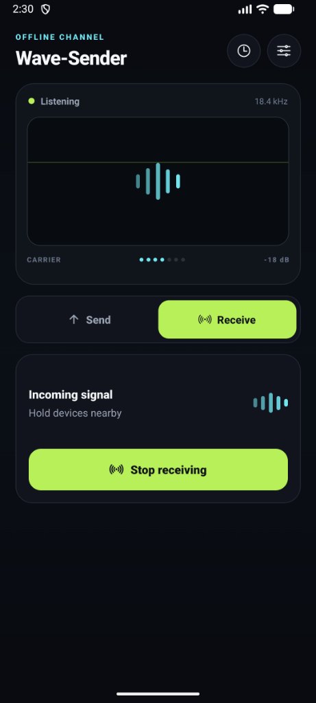

<div align="center">

# 🌊 Wave-Sender

**Offline text delivery over sound — no Wi-Fi, Bluetooth, pairing, or account required.**

[](https://github.com/ToTheBlankWorld/Wave-Sender)
[](https://reactnative.dev)
[](https://expo.dev)
[](https://github.com/ToTheBlankWorld/Wave-Sender/releases/latest)

**Send short messages and links through encoded audio waves.**
<br />Two nearby phones. One transmission. Zero network infrastructure.

[Download APK](https://github.com/ToTheBlankWorld/Wave-Sender/releases/latest) · [Report a bug](https://github.com/ToTheBlankWorld/Wave-Sender/issues) · [View source](https://github.com/ToTheBlankWorld/Wave-Sender)



</div>

---

## ✨ What is Wave-Sender?

Wave-Sender converts short text into audio signals using the **ggwave** data-over-sound codec. A compatible nearby device listens through its microphone, decodes the signal, and saves it locally.

Perfect for demonstrations, offline communication experiments, nearby handoffs, and environments where ordinary network connectivity is unavailable or unwanted.

## 🚀 Latest Release — v1.0.0

- 📡 Native ggwave data-over-sound transmission
- 🎧 Microphone-backed receive mode with runtime Android permission
- 🔊 Audible and ultrasound protocol options
- 📲 Persistent received-message history
- ⚙️ Adjustable volume, haptics, and keep-screen-awake preferences
- 📋 One-tap clipboard copying
- 🧭 Expo Router navigation
- 🌙 Purpose-built dark interface optimized for mobile screens
- 🛡️ Input-size validation and secure local history parsing

## 🧰 Technology

| Area | Technology |
|---|---|
| Framework | React Native 0.88.1 |
| App platform | Expo SDK 58 |
| Navigation | Expo Router |
| Audio codec | ggwave native Nitro module |
| Storage | AsyncStorage |
| Android | Gradle / Android SDK |
| Language | TypeScript |

## 📱 Android Installation

1. Open the **latest release** page.
2. Download `Wave-Sender-v1.0.0.apk`.
3. On Android, enable installation from your browser/file manager if prompted.
4. Install and open **Wave-Sender**.
5. To receive, grant microphone permission and press **Start receiving**.

> ⚠️ Keep both devices nearby, moderately loud, and away from heavy environmental noise.

## 🔊 Usage

### Send

1. Open the **Send** tab.
2. Enter text or a link — 64 UTF-8 bytes maximum.
3. Press **Transmit signal**.
4. Hold the phone near the receiving device.

### Receive

1. Open the **Receive** tab.
2. Press **Start receiving**.
3. Approve microphone access.
4. Keep the app active while the nearby sender plays the audio.
5. Copy or review decoded messages in **Received** history.

## 🛠️ Development

### Requirements

- Node.js 22+
- Android SDK
- JDK 17
- Android device or emulator

### Setup

```bash
npm install
npx expo start
```

### Run on Android

```bash
npx expo run:android
```

### Validate

```bash
npx tsc --noEmit
npx expo lint
npx expo-doctor
```

### Build release APK

```bash
cd android
./gradlew assembleRelease
```

Release APK output:

```text
android/app/build/outputs/apk/release/app-release.apk
```

## 🔏 Release Integrity

Downloaded APKs should match the release checksum:

```text
SHA-256: 160ef08d5341641f1e03efe9334215b25479e7cb726267deafac18788cdbdf57
```

## 🧪 Quality Status

- ✅ Expo Doctor: 20/20 checks passing
- ✅ TypeScript: passing
- ✅ ESLint: passing
- ✅ Android emulator build: installed and tested
- ✅ Receive permission flow: verified
- ✅ Settings and history navigation: verified
- ✅ No high-confidence security findings in the app source review

## 🗂️ Project Structure

```text
src/
├── app/
│   ├── index.tsx       # Send / receive experience
│   ├── history.tsx     # Received message history
│   └── settings.tsx    # App preferences
├── hooks/
│   └── useWaveSender.ts
├── services/
│   ├── history.ts
│   └── settings.ts
└── theme/
    └── colors.ts
```

## 🔐 Privacy

Wave-Sender does not require an account or remote backend. Messages are transmitted through audio and received history is stored locally on the device.

The app requests microphone access only for receive mode. No message or location data is uploaded by the app itself.

## 📄 License

This project is licensed under the MIT License. See [LICENSE](LICENSE).

---

<div align="center">

**Built for offline communication experiments.** 🌊

</div>
